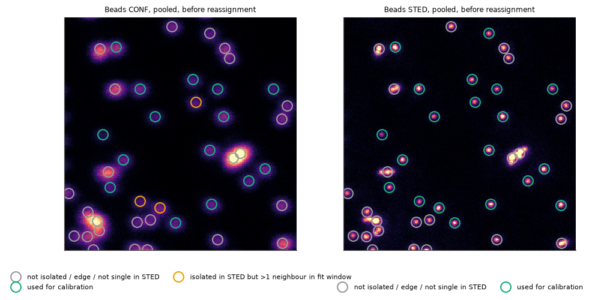
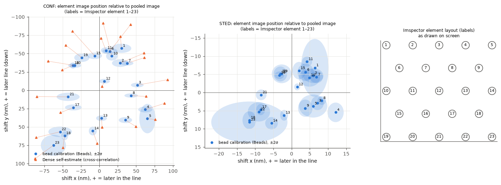
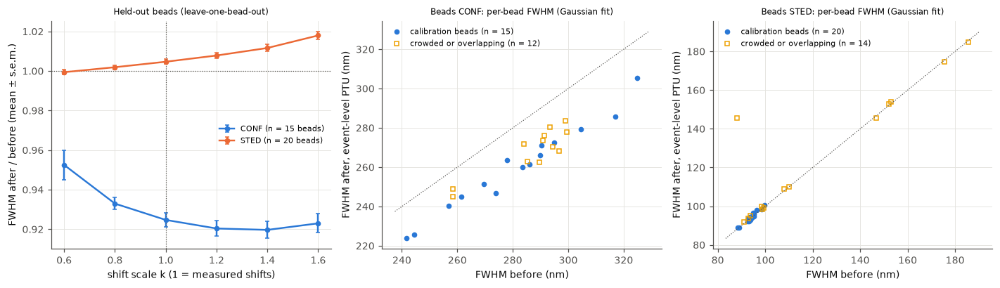
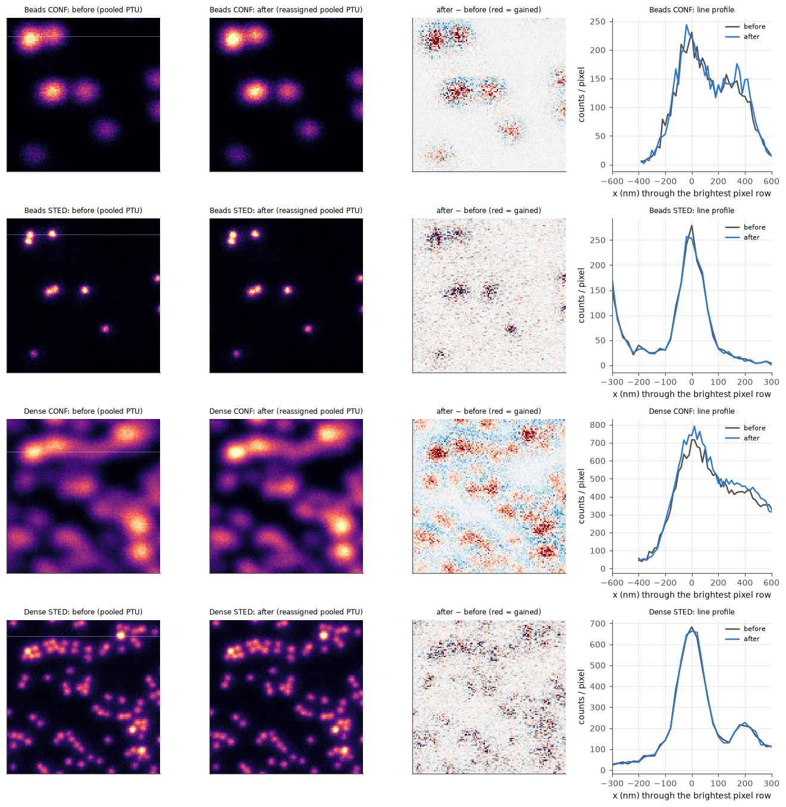
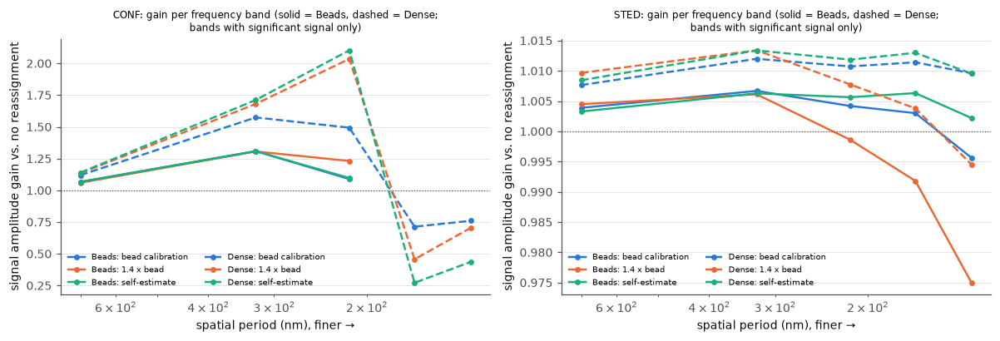

# Pixel reassignment of MATRIX FLIM data with a bead calibration (inputs3: Beads, Dense)

Date: 2026-10-22. Code: `src/matrix2ptu/{ism,beadcal,reassign}.py`, pipeline
`tools/ism_inputs3.py`, figures `tools/ism_figures.py`. Outputs:
`outputs/inputs3_reassignment/` (inventory in its `README.md`).

Labels: **[V]** verified on these data · **[A]** assumption · **[H]** hypothesis
(consistent with the data, not proven) · **[U]** unresolved.

## 0. Summary

| question | answer |
|---|---|
| Do the files contain what reassignment needs? | **Yes [V].** Both `.obf` files are streamed photon-event files (not images). Each photon keeps its detector element, micro time and image position. The conversion reproduces Imspector's images (25/25 checks per dataset). |
| Is the bead calibration reliable? | **Confocal: yes [V].** 15 isolated beads, per-element shifts up to 98 nm with a median uncertainty of 3.3 nm. Held-out beads (leave-one-bead-out) all get narrower: FWHM −7.6 %, 15/15. **STED: shifts measured precisely (≤ 14 nm, ±0.9 nm), but reassigning with them gives no improvement [V]** (FWHM +0.5 % on held-out beads). |
| Same shifts for CONF and STED? | **No [V].** The STED shifts are 0.15 × the confocal ones and rotated by 12–14°. Separate calibrations are used. |
| Applied to Dense? | **Yes, as a conservative transfer, with a caveat.** Dense objects get narrower in confocal: −8.1 %, 28 of 29 objects. Dense's own data, however, indicate about 1.4× larger confocal shifts than the Beads calibration (§5), so Dense is probably under-corrected. STED is unchanged within 0.1 %. |
| PTU after reassignment? | **Yes [V], with one conceptual limitation.** Micro time and detector channel of every photon are unchanged (verified per channel). The macro time of a moved photon is rewritten to encode its new position, so it is no longer the detection time. x is set to 1/4000 pixel, y to whole lines. FLOPA reads the files (headless; GUI not tested). |
| Reuse on other data? | Only for the same detector alignment, objective, pinhole, wavelengths and mode, and **after a check on the target** (§7). The data hint that the calibration may not transfer even between two acquisitions of the same session (§5). |

## 1. Data suitability

### 1.1 Files [V]

| file | content |
|---|---|
| `Beads.obf`, `Dense.obf` | one 1-D uint32 stack `00000` = MATRIX event stream (streaming format 0), plus the full Imspector parameter tree |
| `Beads.msr`, `Dense.msr` | Imspector FLIM cubes (250 × 250 × 250 × 100 ps) of each sequence; parameters identical to those embedded in the `.obf` |

- **Beads:** 2.04 M photons, 1000 line markers (250 lines × 4 passes), 1 frame marker.
- **Dense:** 15.7 M photons, same marker structure.

### 1.2 Acquisition metadata vs. the stated parameters

| parameter | stated | metadata (both files) | |
|---|---|---|---|
| image | 5 × 5 µm, 20 nm → 250 × 250 | 250 × 250 px, 20 nm, 5.0 × 5.0 µm | [V] |
| dwell | 100 µs | 100 µs per line pass (STED channel reports 300 µs = 3 passes) | [V] |
| sequences | CONF ×1, STED ×3 | line steps [1, 3]; per y-line: 1 CONF pass, then 3 STED passes | [V] |
| excitation | 640 nm | EXC640 (CONF power 2.0, STED 2.63; Imspector units) + STED775 (10) in the STED sequence | [V] |
| detection | 650–720 nm | Matrix1 channel 650–720 nm | [V] |
| objective | 60×, NA 1.42 | `60X_NA1.4_oil_UPLXAPO60XO`, i.e. **NA 1.40** | differs |
| pinhole | 8 AU | 7.99 AU (0.8 mm). Imspector computes AU at 605 nm, which is about 7.1 AU at the 685 nm emission centre | [V] |
| STED gating | – | Imspector gate 0.75–8.75 ns on the STED channel. **The PTUs contain all photons (no gate).** | [V] |
| crosstalk filter | – | **off** (see §7.6) | [V] |
| laser sync | – | external, 40.0006 MHz | [V] |

**Beads vs. Dense [V].** Firmware, array id, element delays, objective, pinhole,
lasers and powers, detection range, gating, pixel size, dwell and line steps are
identical. They differ in:
- **scan offset:** Beads (−9.86, −6.84) µm vs. Dense (0, 0), i.e. Beads was imaged 12 µm off the scan centre;
- **focus z offset:** −0.78 vs. −1.23 µm;
- **stage position:** 3.5 mm apart.

The files carry no acquisition timestamps, so the time between the two acquisitions is unknown **[U]**.

### 1.3 What the existing conversion preserves [V]

`configs/{beads,dense}_obf.yaml` were converted with `--validate`: 25/25 checks per dataset.
- **Imspector images:** images from the PTU equal Imspector's `.msr` cubes to within 0.15 % summed absolute difference (r = 1.0000).
- **Per-photon content:** every photon's (time, micro time, element) round-trips exactly.
- **tttrkit/FLOPA:** the reconstruction is identical to our own.

What reassignment needs, and where it is kept:

| needed | kept? |
|---|---|
| element identity per photon | yes, in the **detector-resolved** PTU (channel = element). The pooled PTU has lost it, so reassignment cannot start from a pooled file (the code refuses). |
| image position per photon | yes: line pass from the LineStart markers, x continuous from the time within the line |
| sequence and pass | yes: one PTU per sequence (`split_sequences: true`); STED files have 750 line markers = 250 × 3 |
| micro time | yes, 5 ps bins, element delays corrected (D2 check: residual 32 ps rms) |

**Missing, not essential:**
- the bead type and size (only relative widths are reported);
- the detector-array geometry: element pitch and magnification in the sample plane, not in the metadata;
- acquisition timestamps.

None of these is needed for an empirical shift calibration. The element pitch would be needed to relate the measured shifts to a physical model (§2.5).

## 2. Calibration (Beads)

### 2.1 Method

1. **Element images:** per sequence, 23 images built from the photons of the per-sequence detector-resolved PTU.
2. **Bead detection:** local maxima of the smoothed **STED** pooled image, which separates beads that merge in confocal. This finds 45 sources, 43 above the bead threshold.
3. **Isolated beads:**
   - no other source within 320 nm (16 px);
   - fitting window inside the image;
   - single in STED (second-moment ellipticity ≤ 0.35);
   - at most 1 neighbour reaching into the fitting window.

   Neighbours within reach are **fitted jointly**, each with its own amplitude and position. Without this, a neighbour 20 px away biases the confocal fit, because the confocal σ ≈ 6 px.
4. **Per-bead fit:** for each bead and element, a Poisson maximum-likelihood fit of a symmetric 2-D Gaussian + background. The window is ±240 nm (CONF) or ±120 nm (STED).
5. **Shift definition:** shift = element centre − centre of the pooled image of the same bead.
6. **Combination:** inverse-variance weighted mean over beads. Uncertainty = the larger of the statistical error and the bead-to-bead scatter / √n.
7. **Outliers:** a per-bead pattern scale beyond 4 × MAD is rejected. None was.

Beads used: 15 (CONF) and 20 (STED); f10 shows which beads were used and why the others weren't.



### 2.2 Coordinate convention

- **Axes:** x = scan (fast) axis, + to the right (later within the line); y = line index, + downwards. This is the orientation of Imspector's image stacks: the PTU images equal the `.msr` cubes pixel by pixel.
- **Shift:** s_e is where element e's image lies relative to the pooled image, I_e(r) ≈ I_ref(r − s_e).
- **Reassignment:** moves every photon of element e by −s_e. The reassigned image therefore stays registered to the original pooled image.
- **Element numbering:** data element 0–22 = PTU channel 0–22 = Imspector label 1–23. With the affine lattice fit, this mapping fits better than all 2000 random permutations [V].

### 2.3 Estimated shifts (nm; 20 nm pixels)

| label | CONF x | CONF y | ± (x, y) | STED x | STED y | ± (x, y) |
|---|---|---|---|---|---|---|
| 1 | +29.9 | −57.2 | 6.7, 3.1 | +6.4 | −6.8 | 1.9, 4.0 |
| 2 | +28.1 | −37.1 | 5.5, 2.6 | +5.9 | −4.6 | 1.4, 1.0 |
| 3 | +51.5 | −7.1 | 4.3, 1.6 | +7.1 | +2.9 | 0.9, 1.0 |
| 4 | +62.4 | +26.2 | 4.8, 2.0 | +12.1 | +5.5 | 1.1, 1.3 |
| 5 | +65.4 | +38.6 | 5.5, 10.0 | +5.9 | +3.7 | 1.9, 1.6 |
| 6 | +14.4 | −53.3 | 5.1, 2.0 | +3.8 | −5.6 | 1.1, 1.2 |
| 7 | +37.6 | −36.8 | 4.4, 1.6 | +6.8 | −4.3 | 0.9, 0.8 |
| 8 | +43.1 | +7.2 | 4.6, 1.5 | +8.3 | +2.2 | 0.6, 0.6 |
| 9 | +35.4 | +40.7 | 4.6, 2.0 | +3.7 | +4.3 | 1.0, 1.2 |
| 10 | +16.9 | −46.6 | 3.9, 3.1 | +4.9 | −4.1 | 1.5, 1.2 |
| 11 | +8.9 | −54.2 | 3.5, 2.2 | +4.2 | −8.5 | 0.7, 0.7 |
| 12 | +6.8 | −12.4 | 3.7, 1.6 | +1.5 | −1.5 | 0.4, 0.5 |
| 13 | +2.9 | +38.1 | 3.7, 1.9 | −2.1 | +6.3 | 0.5, 0.7 |
| 14 | −9.0 | +55.5 | 2.7, 3.0 | −5.5 | +8.5 | 0.9, 0.9 |
| 15 | −6.5 | −47.0 | 5.0, 2.2 | +2.0 | −6.0 | 0.9, 1.2 |
| 16 | −36.1 | −33.8 | 2.2, 2.1 | −3.4 | −4.7 | 0.6, 0.5 |
| 17 | −35.4 | +23.4 | 5.7, 2.0 | −8.5 | +4.7 | 0.6, 0.8 |
| 18 | −47.3 | +62.0 | 2.3, 3.1 | −11.6 | +7.6 | 0.9, 1.2 |
| 19 | −23.9 | −44.5 | 5.2, 2.9 | −2.7 | −5.1 | 1.4, 1.3 |
| 20 | −33.6 | −33.8 | 4.6, 1.5 | −3.1 | −5.1 | 0.9, 1.0 |
| 21 | −42.6 | +9.0 | 7.8, 2.8 | −8.4 | +0.6 | 0.7, 0.7 |
| 22 | −53.4 | +56.6 | 8.0, 3.6 | −9.0 | +5.3 | 1.5, 1.3 |
| 23 | −62.6 | +75.1 | 8.6, 7.1 | −11.6 | +8.2 | 5.2, 2.8 |

Machine-readable copy: `configs/calibration/MATRIX1_ism_shifts_2026-10-22_Beads640_8AU.json`.
The full version, with per-bead values and diagnostics, is `outputs/inputs3_reassignment/2_calibration/Beads_ism_calibration.json`.



### 2.4 Reliability [V]

| test | CONF | STED |
|---|---|---|
| beads used | 15 (3 more excluded: crowded) | 20 |
| median uncertainty | 3.3 nm (statistical 1.6 nm; bead-to-bead scatter 1.5 × photon noise, χ² 2.1) | 0.9 nm (χ² 1.1: scatter = photon noise) |
| isolation radius 240 / 400 nm instead of 320 nm | shifts change by 0.5 / 1.2 nm rms | 0.9 / 0.7 nm rms |
| two independent bead halves (left/right of the field; alternating) | agree: rms z = 0.64 / 1.15; pattern scale ratio 1.02 / 1.07 | rms z = 0.82 / 0.83 |
| field dependence (per-bead pattern scale vs position) | not significant: change over 5 µm in y −0.17 ± 0.09 (t = −1.9), in x +0.05 ± 0.08 | y −0.38 ± 0.22 (t = −1.7) |
| independent estimator (cross-correlation of each element with the sum of the others, whole image) | pattern scale 1.008, residual 0.22 px | 0.80: estimator not equivalent for STED (§2.6) |
| hexagonal lattice model (affine) | **does not fit**: residual 0.95 px vs 0.31 px uncertainty | residual 0.20 vs 0.10 px |

- **Lattice model not used:** it would add up to 2 px errors (outer elements), so measured per-element shifts are used.
- **Weakest elements:** elements 1 and 23 (corners, about 200 photons per bead in confocal) have the largest uncertainties (7–9 nm).
- **Bead-to-bead variation:** the extra confocal scatter (per-bead pattern scale sd 7.6 %) is unexplained [U]. Candidates are bead size, bead height and residual neighbour light.

### 2.5 Geometric element positions vs. measured shifts

The **geometric** position of an element is its location in the detector plane,
back-projected into the sample (d_e). A **measured** shift (s_e) is where the element's
image appears. In the Gaussian approximation s_e ≈ α·d_e, with α = σ_det²/(σ_exc²+σ_det²)
≈ 0.5 for confocal and much smaller for STED, where the effective excitation spot is
narrow. Only s_e was measured.

The fitted lattice gives 32.0 nm per element pitch in confocal and 4.8 nm in STED. With α ≈ 0.5, the back-projected pitch would be about 64 nm [H]. No geometry is in the metadata, so d_e itself is unknown [U]. Shifts are also not linear in d_e for the outer elements (lattice misfit above), as expected when the PSFs are not Gaussian.

For comparison, on the same pooled-image reference the previous round's data give 42 nm/pitch (640 nm, 1 AU) and 59 nm/pitch (561 nm, 8 AU, Lightbox), against 32 nm/pitch (Beads) and 48 nm/pitch (Dense, self-estimate) this round. PIXEL_REASSIGNMENT.md quotes 51 and 63 nm/pitch for the same data; those use the leave-one-out reference, which is larger by 1/(1 − photon fraction). **The shift scale differs between sessions and, here, between two acquisitions of one session (§5).**

### 2.6 Does reassignment help? Held-out beads [V]

For each bead, the shifts are computed from all *other* beads, applied (scaled by k)
to that bead's element images, and the pooled bead is refitted (f12, left).

| k (× measured shifts) | 0.6 | 0.8 | **1.0** | 1.2 | 1.4 | 1.6 |
|---|---|---|---|---|---|---|
| CONF FWHM after/before (mean ± s.e.m.) | 0.953 ± .008 | 0.933 ± .003 | **0.925 ± .004** | 0.920 ± .004 | 0.920 ± .004 | 0.923 ± .005 |
| STED FWHM after/before | 0.999 ± .001 | 1.002 ± .001 | **1.005 ± .001** | 1.008 | 1.012 | 1.018 |

**Confocal:**
- FWHM 283.5 → 261.8 nm (median), peak +10.7 %, 15/15 beads narrower.
- The optimum is flat between k = 1.0 and 1.6, so the measured shifts are close to optimal.
- The central element alone gives 244.5 nm, with about 10 % of the photons.

**STED:**
- No gain at any k. Bead FWHM is 94 nm, and the shifts (≤ 0.7 px) are small compared with it.
- Applying them adds 0.5 % width. The STED shift is also scale-dependent (§5.1): the finest detail (111–182 nm periods) aligns with about 0.5 × the Gaussian-fit shift, coarse detail (> 400 nm) with about 2×. This is consistent with a narrow STED core plus a broad confocal-like halo in each element's PSF.
- Reassignment brings no measurable benefit for STED on these data. The STED files were still produced (§6), clearly labelled.

## 3. Processing (both datasets, each sequence separately)

1. **Original split files:** one PTU per sequence, detector-resolved and pooled.
2. **Calibration selection:** CONF photons use the CONF shift table, STED photons the STED table. The shifts are converted from nm to pixels of the target (20 nm here).
3. **Event-level reassignment** (`reassign.reassign_times`), for each photon of element e inside a line window:
   - **x:** x' = x − s_x. The new macro time is LineStart + x'/250 × line length, accurate to 1 laser period = 1/4000 pixel.
   - **y:** line y' = y − round(s_y) at the **same pass index**, so STED pass 1/2/3 stays pass 1/2/3.
   - **unchanged:** micro time and channel.
   - **out of field:** photons that would leave the field are dropped. Confocal: 1.3 % (border 4 px); STED: ≤ 0.13 % (border 1 px).
   - **flyback:** photons outside the line windows keep their time (≤ 0.24 % of photons).
4. **Writing:** photons and the original markers are time-sorted and written. The header is the original plus `UsrMX_Reassigned*` tags (calibration, sequence, per-element shifts, method), with a new File_GUID.
   - **Detector-resolved file:** channels = elements.
   - **Pooled file:** the same reassigned photons in channel 0.

**Sub-pixel shifts.**
- **x:** exact, because x is continuous in time.
- **y:** whole lines. Rounding leaves an element-specific residual ≤ 0.5 px (10 nm): up to 0.45 px for confocal; for STED all |s_y| < 0.5 px, so **STED y-shifts round to 0**.
- **Effect of rounding:**
  - Bead FWHM ratio is 0.9241 with rounding vs. 0.9240 with an exact Fourier sub-pixel shift.
  - The images agree at r = 0.996.
  - Stochastic rounding (`--y-rounding stochastic`: unbiased, but adds a 2-line spread) was worse: 0.928.
- **No interpolation:** no photon is split, no counts are interpolated, and no photons are created. The exact sub-pixel version is provided only as an image (`*_reassigned-fourier.tif`); it is not photon counts and can have small ringing.

**What the reassigned PTU means.**
- Micro time, channel and the line/frame markers are the original values.
- The macro time of a moved photon is **a position code**, not the detection time; the header and File_Comment say so.
- Fine for: images, decays, lifetimes and phasors per pixel.
- Not usable for: time traces, FCS/correlation or anything needing photon detection times. Use the original PTUs for those.

## 4. Output files

See `outputs/inputs3_reassignment/README.md`. Per dataset (Beads, Dense) and sequence (seq0-CONF, seq1-STED):

| | original (`1_original/`) | reassigned (`3_reassigned/`) |
|---|---|---|
| detector-resolved PTU (23 channels) | `<D>_seq<i>-<S>_detector-resolved_original.ptu` | `..._detector-resolved_reassigned.ptu` |
| pooled PTU (1 channel) | `<D>_seq<i>-<S>_pooled_original.ptu` | `..._pooled_reassigned.ptu` |
| images (TIFF float32) | `*_pooled_original.tif` | `*_pooled_reassigned-events.tif` (= PTU), `*_pooled_reassigned-fourier.tif` (exact sub-pixel reference), `*_elements_reassigned-events.tif` (23 × Y × X) |

FLOPA: lines 250, pixels 250, line accumulations `(1)` for CONF and `(3)` for STED files.

Limitations:
- **Dense:** reassigned with a transferred calibration (§5).
- **STED reassigned files:** no benefit (§2.6).
- **Edges:** border pixels (4 px confocal) have fewer photons after reassignment; nothing moves in from outside the field.
- **Gating:** the PTUs contain ungated STED photons; apply a time gate in FLOPA if wanted.

## 5. Transfer of the Beads calibration to Dense

### 5.1 Evidence

| check | Beads | Dense |
|---|---|---|
| settings (§1.2) | | identical except scan offset (12 µm), focus offset (0.45 µm), stage position |
| object width, CONF (median FWHM) | 284 nm | 291 nm |
| object width, STED | 95 nm (IQR 93–99) | 161 nm (IQR 134–196) |
| self-estimated CONF shifts / Beads calibration (pattern scale) | 1.008 | **1.41** (image quadrants 1.30, 1.34, 1.09, 0.99) |
| residual misalignment after reassignment (self-estimate rms) | 2.8 → 0.4 px | 4.0 → **1.5 px** |
| CONF signal gain, 250–400 / 182–250 nm periods, with bead shifts | 1.31 / 1.09 | 1.57 / 1.49 |
| … with 1.4 × bead shifts | 1.31 / 1.23 | 1.68 / 2.04 |
| CONF self-estimate restricted to periods > 400 nm / 250–400 nm (reliable bands) | 1.05 / 0.98 | **1.45 / 1.32** |
| CONF objects narrower after reassignment | 15/15 (−7.6 %) | 28/29 (−8.1 %, peak +19 %) |

- The self-estimate (cross-correlation) agrees with the bead fit on Beads, so it isn't biased as an estimator in confocal.
- Blurring the Beads images to mimic larger or crowded objects (up to σ = 6 px) changes the confocal self-estimate by < 3 % [V]. Object size does **not** explain the 1.41.
- In STED, both estimators depend strongly on object size: blurring by 3–4 px gives 1.5–1.75× larger shifts [V]. The STED discrepancy (Dense 1.08×, and 1.67× from Dense's own isolated objects) is explained by Dense's wider objects.
- **Interpretation:** for confocal, Dense's element images are about 1.4× further apart than in Beads, varying across the field (0.99–1.34 by quadrant).

### 5.2 Possible causes [H/U]

- **Scan offset:** Beads was scanned 12 µm off-centre, Dense on-centre; field-dependent descanning or vignetting could change the shift pattern.
- **Sample:** a different focus and depth, or a thicker or multi-layer sample. This would also explain the wider and more variable STED widths in Dense.

These data can't separate the two. The field-dependence test *within* Beads (5 µm) shows no significant trend.

### 5.3 Decision

The Beads calibration was applied to Dense unchanged.
- **Why it's acceptable:**
  - It improves Dense in every check that is independent of the transfer question: object widths, signal in the 182–1000 nm bands, and residual misalignment.
  - The bead optimum is flat (k = 1.0–1.6), so the error is in the safe direction: **under-correction, not artefacts**.
- **What it means for Dense:** confocal is probably less sharp than achievable, and its shift table is not validated on Dense itself.
- **Not done:** using Dense's own self-estimate instead. That estimate varies by ±15 % across the field.
- **Proper fix:** beads acquired at the same scan offset and focus as the target (§8).

## 6. Validation

### 6.1 Checks performed [V]

| check | result |
|---|---|
| original PTUs readable by independent readers (ptufile; tttrkit = FLOPA's reader) | yes, all 8; structure, counts, markers, round trip, timing: 25/25 checks per dataset (combined files) |
| original images vs Imspector `.msr` cubes (per sequence) | counts equal to within 91 of 10.9 M; identical pixels 97 / 98 % (Beads CONF/STED), 79 / 90 % (Dense); r = 1.0000 |
| detector-resolved vs pooled (originals) | sum of the 23 channel images = pooled image, exactly, all 4 |
| reassigned PTUs: structure | readable by ptufile; time monotonic; line and frame markers identical in number to the source (250 or 750) |
| reassigned PTUs: photons | per channel = source − dropped, exactly |
| reassigned PTUs: timing | **the multiset of micro times per channel equals that of the kept source photons**, all 8 files |
| reassigned PTUs: image | the image from the PTU equals the image from the photon table, exactly; vs. the continuous positions: ≤ 0.03 % of photons one pixel off (photons within 1/4000 px of a pixel edge) |
| reassigned PTUs in tttrkit / napari-flopa | tttrkit image identical to ours (all 8); napari-flopa (commit 9602fcd, headless) reconstructs count, mean arrival time and phasor, dims (1, 1, 250, 250, ch) |
| FLIM after reassignment (FLOPA, pixels ≥ 100 photons) | count-weighted mean arrival time changes by +7, −5, +0.7, −3.5 ps (Beads CONF/STED, Dense CONF/STED); phasor g, s change ≤ 0.001. Per-pixel values change (median 0.15–0.31 ns) because each pixel now holds a different set of photons. |
| sequences / accumulation | CONF files 250 line markers, accumulation 1; STED files 750, accumulation 3; photons keep their pass index |

### 6.2 Before vs after, per sequence

| | objects | FWHM before → after (median) | narrower | peak |
|---|---|---|---|---|
| Beads CONF, held-out (leave-one-out) | 15 | 283.5 → 261.8 nm (×0.924) | 15/15 | +10.7 % |
| Beads CONF, crowded/overlapping beads not used for calibration | 12 | 291.1 → 271.1 nm (×0.944) | 12/12 | +12.7 % |
| Dense CONF, quasi-isolated objects | 29 | 290.8 → 264.5 nm (×0.919) | 28/29 | +19.3 % |
| Beads STED, calibration beads | 20 | 93.9 → 94.0 nm (×1.001) | 9/20 | +0.1 % |
| Beads STED, crowded beads | 14 | ×1.006 | 5/14 | |
| Dense STED, quasi-isolated objects | 34 | 161.2 → 160.1 nm (×0.999) | 21/34 | +0.5 % |

The **independent** improvement measures are the held-out beads, the crowded beads
(not used for the calibration) and Dense.





### 6.3 Artefacts checked

- **Overlapping beads:** they improve like isolated ones (×0.944, 12/12), with no doubled or ghost structures in the difference images (f13).
- **Neighbour contamination in the calibration:** isolation radius 240–400 nm changes the shifts by ≤ 1.2 nm. Beads with ≥ 2 neighbours gave biased shifts in a first test (pattern scale 0.2–0.6) and are excluded.
- **Interpolation:** none in the PTUs. The Fourier reference differs from the event image by the y rounding only (r = 0.996).
- **Edges:** a border of ceil(max |s|) px loses photons (4 px CONF, 1 px STED). Exclude it from quantitative analysis.
- **Background:** handled by the fitted constant. The STED pooled background is about 5 counts/px (Beads), 47 (Dense).
- **Detector crosstalk [V]:**
  - Same-laser-pulse photon pairs in *neighbouring* elements occur 4.4× (Beads) and 2.2× (Dense) more often than by chance. That is an excess of 1.2 % of all photons; distant elements are at chance level (0.98–1.02).
  - Imspector's crosstalk filter was off.
  - Crosstalk photons are recorded in the neighbour element and therefore reassigned with the neighbour's shift (about 30–40 nm off): a small blur.
  - The filter can't be applied after the fact without knowing the true origin of each photon.
- **Resolution by FRC is not reliable on these data [V]:**
  - Two random photon halves stay correlated *beyond* the confocal optical cutoff: Dense FRC 0.14 ± 0.01 at 83–111 nm periods, cutoff about 118 nm. That correlation can't be optical.
  - Part of it is the crosstalk pairs. The rest is unexplained [U]; count-rate non-linearity is a candidate [H].
  - Reassignment smears these correlations, so the FRC 1/7 crossing *worsens* after reassignment (Beads CONF 184 → 209 nm, Dense 155 → 184 nm; 8 splits), while bead FWHM improves. Bead widths are therefore used as the resolution measure.
  - A real loss of the weakest confocal frequencies (< 180 nm periods) cannot be fully excluded [U].

### 6.4 Not performed / to do locally

- **napari-flopa GUI:** open the reassigned and original files with lines 250, pixels 250, accumulations `(1)` (CONF) / `(3)` (STED), and compare lifetime maps. The headless check uses FLOPA's own reconstruction functions.
- **SymPhoTime:** not tested; no compatibility claim.
- **Absolute resolution:** needs the bead size.
- **Ground truth for Dense:** none.

## 7. Applicability to other datasets

**What sets the shifts.**
- **Detector geometry:** which element sees which part of the image plane, i.e. the element positions and the detector-to-sample magnification. Also its alignment to the pinhole and optical axis.
- **PSFs:** the excitation and detection PSFs, which set α and the non-linearity.
- **Estimation accuracy:** depends on photons, sampling and sample sparsity.

| setting | role | if changed |
|---|---|---|
| detector, its alignment, relay/zoom optics | geometry | recalibrate |
| pinhole setting (AU) | geometry (aperture in front of the array) + PSF | recalibrate (the previous round's 1 AU data differed) |
| objective / NA, immersion | geometry (magnification) + PSF | recalibrate |
| excitation wavelength | PSF (α) | recalibrate |
| emission band / dichroics / dye | PSF (α), and possibly the beam path | recalibrate |
| confocal vs STED | PSF: completely different shifts | separate calibration per mode (done) |
| STED power, donut quality, gating | PSF (STED shifts) | recalibrate STED; confocal unaffected |
| pixel size | units only (shifts are stored in nm) | reuse; the shift in px = nm / pixel size |
| image size / field of view | none, as long as the field stays within the calibrated area | reuse |
| scan offset / position in the scan field | **possibly geometry** (§5, unverified) | until tested, calibrate at the same offset |
| dwell time, line accumulation, number of sequences | none for geometry; they change photon counts only | reuse |
| sample mounting, refractive index, depth, focus | PSF (aberrations, defocus); possibly why Dense differs (§5) | recalibrate for different mounting or depth; check on the target |
| date / realignment | geometry drift | check each session |

**Reuse rule:**
1. Same detector alignment, objective, pinhole, wavelengths, emission band and mode, ideally the same session and scan position.
2. Then check on the target. `ism-reassign --metadata` lists every setting that differs. A self-estimate on the target should be consistent with the calibration, as Beads was (pattern scale 1.0 ± 0.1); Dense was not (1.4).
3. If not consistent, acquire new beads.

## 8. Recommendations

1. **Bead calibration at the target's conditions:** the same scan offset and focus, ideally right before or after the target and in the same mounting medium. Several fields help.
   - It would show whether the scan offset explains the Beads–Dense difference.
   - A short series of the same beads at offsets 0 / ±10 µm would test that directly.
2. **More isolated beads for confocal:** about 40, at least 1 µm apart, would halve the confocal uncertainty and test the field dependence (current hint: t = −1.9).
   - **Sparser beads**, or larger fields of view with the same pixel size.
3. **Bead information:** type and diameter, for absolute FWHM statements.
4. **Crosstalk:** enable the MATRIX crosstalk filter, or measure crosstalk per element pair, before further reassignment work. It affects both the reassignment and FRC.
5. **STED:** reassignment of the photons as done here has no benefit at this STED power. Options with potential:
   - time-gated reassignment (shifts per micro-time window);
   - a frequency-dependent (Fourier-reweighted / multi-image deconvolution) approach. The confocal data also show frequency-dependent optimal shifts;
   - both are beyond simple pixel reassignment.
6. **Software:** a FLOPA option to read reassignment shift tables directly (image-domain reassignment of detector-resolved data) would avoid rewriting macro times.
7. **Timestamps:** keep acquisition timestamps in the files, or note them; the session order matters for drift.

## 9. Reproducing / reusing

```bash
# this round (all stages; ~25 min)
.venv/bin/python tools/ism_inputs3.py all

# a new bead calibration (per-sequence detector-resolved PTUs from split_sequences: true)
PYTHONPATH=src .venv/bin/python -m matrix2ptu ism-calibrate \
    --seq CONF=beads_seq0-CONF_detector-resolved.ptu --seq STED=beads_seq1-STED_detector-resolved.ptu \
    --detect-in STED --metadata Beads.obf --out my_calibration.json

# apply to a target sequence (writes detector-resolved + pooled reassigned PTU + report)
PYTHONPATH=src .venv/bin/python -m matrix2ptu ism-reassign target_seq0-CONF_detector-resolved_original.ptu \
    --calibration my_calibration.json --sequence CONF --out-dir out/ --metadata Target.obf
```

The calibration JSON records the acquisition fingerprint. `ism-reassign --metadata`
warns about every setting that differs from it.
