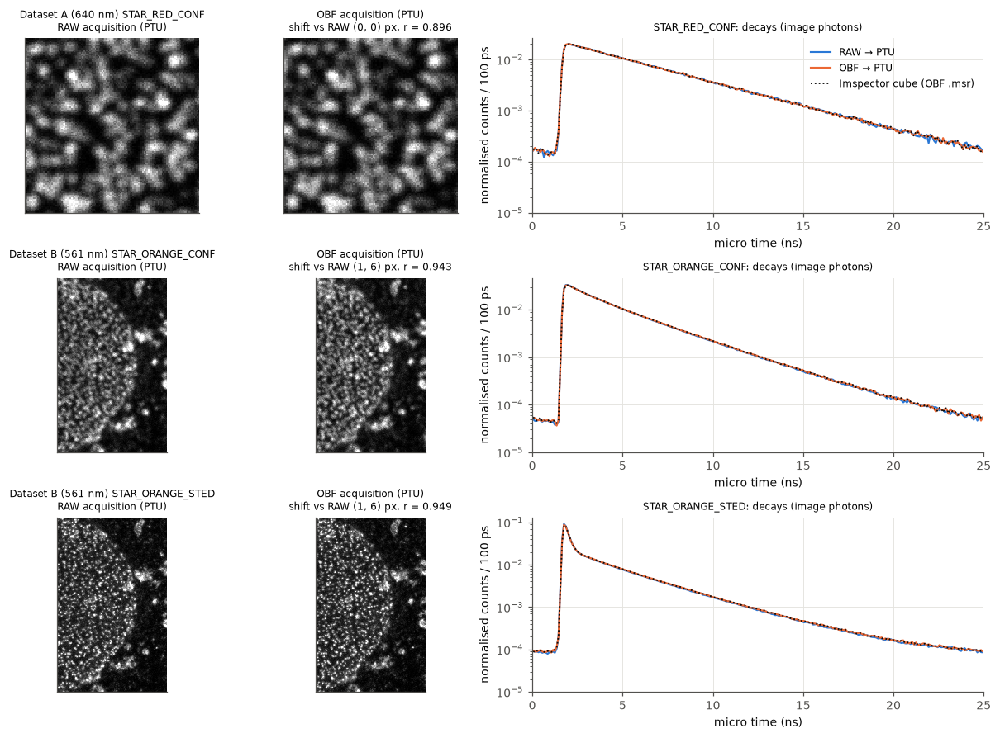
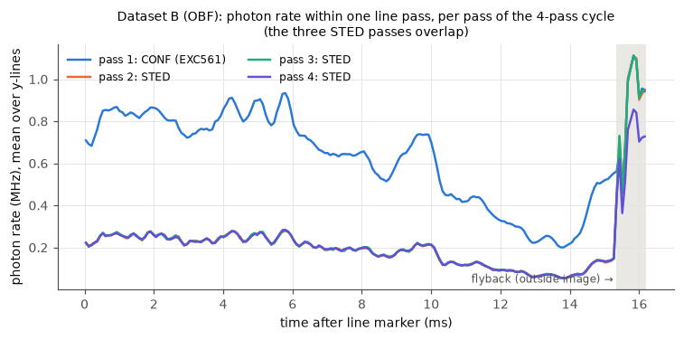

# MATRIX `.obf` → PTU: technical and validation report

*matrix2ptu 0.1.0 — 2026-10-21. Builds on [REPORT.md](REPORT.md), the `.raw` → PTU work.*

Labels, as in REPORT.md:
* **[V] verified**: shown directly by the data, or by agreement between independent sources.
* **[A] Abberior statement**.
* **[H] hypothesis**: consistent with the data, but not proven.
* **[U] unresolved**.

Pixel reassignment is assessed separately in [PIXEL_REASSIGNMENT.md](PIXEL_REASSIGNMENT.md).

---

## 1. Summary

1. **"OBF" covers three different kinds of file [V].** Only one of them contains photon events:

   | file | what is inside | events? |
   |---|---|---|
   | `MatrixOBF.obf`, `Sequence_orangebeadsOBF.obf` (**streamed** acquisition) | one 1-D uint32 stack holding the **same 32-bit MATRIX event words as a `.raw` file**, plus the full Imspector parameter tree | **yes** |
   | `*.msr` (Imspector measurement, OBF container) | Imspector's TCSPC cubes (Y × X × 250 bins of 100 ps, all elements summed) plus the parameter tree | no (histograms) |
   | `MatrixLB.obf` (Lightbox image) | 23 per-element **intensity** images (no time axis) plus OME-XML | no (intensity only) |

2. **Event-preserving conversion of the streamed `.obf` is feasible and implemented [V].**
   - The event stack decodes with exactly the V5 layout of the `.raw` stream.
   - The existing validated pipeline (TDC calibration, pulse reconstruction, PTU writer) is reused unchanged. Only the input layer is new.
   - **Control test:** the words were copied out of the `.obf` into a plain `.raw` file and converted again. The PTU record sections are **byte-identical** to those from the direct `.obf` conversion, for both datasets.
3. **The parameter tree records the stream format [V].**
   - `/hwr/Matrix1/data/streaming/format` is **4** in both `.raw` acquisitions and **0** in both `.obf` acquisitions.
   - The `.obf` therefore *is* Imspector's stream-to-disk output, in OBF format instead of raw.
4. **The streamed `.obf` is self-describing [V].**
   - It embeds the Imspector parameters of the acquisition: image size, pixel size, dwell, line steps, lasers, sync source, per-element delays.
   - These equal those in the matching `.msr` (all cross-checked keys agree), so no `.msr` is needed to convert it.
   - The `.msr` remains valuable as an **independent validation reference** (Imspector's own FLIM cubes).
5. **All four new acquisitions convert and validate [V].**
   - Photon counts, markers, event round trip, images vs Imspector and decays vs Imspector all pass.
   - napari-flopa's own core functions reproduce the image counts and Imspector's per-pixel lifetime information (§5).
6. **The RAW and OBF routes carry the same information [V].** Differences between the paired files match two separate acquisitions (§6):
   - photon counts −0.5 % (A) and −6 % (B);
   - a (1, 6) px field shift in B;
   - image correlation at the Poisson-noise limit after registration;
   - equal per-element timing to 3.7 ps rms.
   - **For FLIM both are equally suitable.** The `.obf` is the more convenient choice because it carries its own metadata.

---

## 2. Inputs inspected

| file | size | inspected | content |
|---|---|---|---|
| `MatrixOBF.obf` | 11.2 MB | yes | streamed acquisition: stack `00000`, 2 655 230 uint32 words (2 654 448 + 782 zero padding), uncompressed, data at byte 407; footer = parameter tree (541 kB XML) + stub OME-XML |
| `MatrixRAW.raw` | 10.6 MB | yes | headerless stream, 2 638 068 words + 778 zero padding |
| `Sequence_orangebeadsOBF.obf` | 200 MB | yes | as above, 49 906 686 words (49 905 912 + 774 padding) |
| `Sequence_orangebeadsRAW.raw` | 202 MB | yes | 50 544 884 words + 778 padding |
| `MatrixOBF.msr`, `MatrixRAW.msr` | 1.8 MB | yes | cube `STAR RED_CONF {1}` (1 × 125 × 125 × 250, int16) + 250-bin `[Pop]` stack |
| `Sequence_orangebeads{OBF,RAW}.msr` | 12 MB | yes | cubes `STAR ORANGE_CONF {3}`, `STAR ORANGE_STED {3}` (487 × 307 × 250) |
| `MatrixLB.obf` + screenshots + CSV | — | yes | see [PIXEL_REASSIGNMENT.md](PIXEL_REASSIGNMENT.md) |

The streamed `.obf` stack has no physical axis information (length 0, one axis). Its OME-XML is a placeholder: a 1 × 1 uint32 "MetadataOnly" image [V]. The parameter tree is the only meaningful metadata.

---

## 3. Format findings for the streamed `.obf`

### 3.1 Container [V]

- OBF file header (`OMAS_BF\n\xff\xff`, version 2), then a single stack (`OMAS_BF_STACK`).
- The stack is rank 1, data type `0x10` (uint32), compression 0, and is named `00000`. It is followed by a footer containing the Imspector parameter tree.
- `obf.find_event_stream()` accepts exactly one such stack. It **refuses** with an explanation:
  - image-only OBFs (e.g. `MatrixLB.obf`, `.msr`): they contain no events;
  - several candidate stacks or a compressed stack: never seen, so not guessed.
- The reader seeks from header to header and never loads the 200 MB file into memory.

### 3.2 Event words [V]

The statistics of the decoded words in each acquisition:

| | MatrixRAW | MatrixOBF | OrangebeadsRAW | OrangebeadsOBF |
|---|---|---|---|---|
| photon-type words | 2 637 942 | 2 654 322 | 50 542 935 | 49 903 963 |
| of which sync (element 23) | 2 094 000 | 2 113 318 | 39 791 429 | 39 796 341 |
| SPAD photons (elements 0–22) | 543 942 | 541 004 | 10 751 506 | 10 107 622 |
| line markers / frame markers | 125 / 1 | 125 / 1 | 1948 / 1 | 1948 / 1 |
| "general" / other words, marker payload ≠ 0 | 0 | 0 | 0 | 0 |
| sync period (coarse ticks) | 78.334 | 78.334 | 78.333 | 78.333 |
| missing sync records (bridged) | 0 | 0 | 23 | 26 |
| coarse tick (ns) | 10.2127 | 10.2127 | 10.2127 | 10.2127 |
| sync jitter (ps rms) | 38.3 | 38.2 | 25.1 | 25.1 |

- The layout is `[1][5 element][10 TDC][16 coarse]` for photons and sync, and `[001][F][L][P][10][16 coarse]` for markers. The trailing zero padding is the same as in `.raw`.
- The timing model established for `.raw` applies **because the words are the same**, not by assumption:
  - the sync is laser/32;
  - the coarse counter is not locked to the laser;
  - the micro time is reconstructed from the sync train ([A] + [V], REPORT §3).

  The checks that make it apply (sync regularity, marker counts, flyback, TDC tables) were re-run on each file. The tables in §3.2, §5 and §6 show that they hold.
- **Missing syncs in dataset B [V]:** 23 (RAW) and 26 (OBF), bridged unambiguously. As in Sequence.raw they coincide with line markers.

### 3.3 Metadata [V]

Embedded `.obf` parameters vs the `.msr` of the same acquisition:
- all cross-checked keys agree: size, pixel size, FOV, offsets, dwell, line steps, line frequency, sync source, firmware, array id, delays, channels and lasers;
- the `.msr` has 12 extra `/meta_data/*` keys (rescue settings, dwell summary), which are not needed.

**Dataset A** (`MatrixRAW.msr` = `MatrixOBF.msr` = embedded `.obf`):

| | user | metadata |
|---|---|---|
| FOV | 5 × 5 µm | 5 × 5 µm |
| pixel | 40 × 40 nm | 40 × 40 nm |
| image | 125 × 125 | 125 × 125 |
| dwell | 100 µs | 100 µs (`pixel_steps/total`) |
| line accumulation | 1 | line steps [1] |
| sequences | 1 | 1 channel `STAR RED_CONF` |

- Additional: EXC640 at 0.5 % (one laser); internal 40 MHz sync (`sync_source/input = -1`); crosstalk filter off; no gating; mono-directional xy scan; 75.19 Hz line frequency.

**Dataset B:**

| | user | metadata |
|---|---|---|
| pixel | 30 × 30 nm | 30 × 30 nm |
| image | 307 × 487 | 307 (x) × 487 (y), FOV 9.21 × 14.61 µm |
| dwell | 50 µs | 50 µs per pass |
| sequences | 2 | 2 channels: `STAR ORANGE_CONF`, `STAR ORANGE_STED` |
| line accumulations | 1 and 3 | line steps **[1, 3]** |

- **Line accumulation interpretation confirmed [V], from three independent sources:**
  - the `.msr` line steps [1, 3], with channel step masks CONF = step 1 and STED = step 2;
  - Imspector's per-channel dwell is 50 µs and 150 µs (= 1 × and 3 × 50 µs);
  - in the event stream, 1948 line markers = 487 × (1 + 3), and the photon counts per pass repeat with period 4: **10 200, 2 952, 2 949, 2 952** photons per pass (RAW; OBF 9 496, 2 805, 2 813, 2 806).

  So for each y-line: one CONF pass, then three STED passes, then the next line.
- **Not in the task description [V]:** sequence 2 is a **STED** channel:
  - EXC561 at 2.63 % plus **STED775** at 10 %;
  - time gating active in Imspector (delay 0.75 ns, width 8 ns);
  - CONF uses EXC561 at 2.0 %.
- The sync is **external** (`sync_source/input = 1`, STED laser), measured at **40 000 568 Hz** (RAW 40 000 567.9, OBF 40 000 568.3). Imspector's stored reading is 40 000 562.7 Hz (0.14 ppm lower; same behaviour as REPORT §3.4).
- Detector elements and acquisition sequences are separate dimensions. All 23 elements contribute to both sequences (element fractions in §6).

### 3.4 What is *not* in the streamed `.obf` [V]

- No acquisition timestamp, in the `.obf` or in any of the `.msr` files. The **acquisition order** of the RAW and OBF acquisitions therefore cannot be established from the files [U].
- No pixel markers and no line-end markers. Sequence and accumulation are not encoded in the markers (payload always 0). This is the same as `.raw`.
- No Abberior TDC calibration: the converter calibrates the TDCs itself (§4.2).

---

## 4. Converter

### 4.1 Usage

```bash
matrix2ptu inspect inputs2/MatrixOBF.obf --msr inputs2/MatrixOBF.msr
matrix2ptu convert configs/matrix_obf.yaml --validate
matrix2ptu convert configs/orangebeads_obf.yaml --validate
```

- **Config:** use `input.obf: <file>` instead of `input.raw`; exactly one of the two must be given. `input.msr` is optional.
  - Without a `.msr`, all `auto` values come from the embedded parameters (provenance "embedded .obf parameters").
  - With a `.msr`, its parameters are cross-checked and any difference is a warning.
  - The `.msr` cubes are the validation reference.
- **Configs for the new data:**
  - `configs/matrix_obf.yaml` and `matrix_raw640.yaml` (dataset A);
  - `configs/orangebeads_obf.yaml` and `orangebeads_raw.yaml` (dataset B; FLOPA line accumulations `(1, 3)`).
- **Outputs:** as for `.raw` (README §2), with `UsrMX_SourceFormat` added to the PTU header. The conversion report has a `source` block: container, stack name, byte offset and streaming format.

### 4.2 TDC calibration for dim data (dataset A) [V]

- Dataset A has only 0.54 M photons. Edge element 22 has 944 photons, below the 1000-event minimum for a per-element code-density table. Self-calibration of the weak elements would add 50–90 ps of noise.
- **Fix:** both dataset-A configs use the table measured on the bright dataset B of the same session and detector, `configs/calibration/MATRIX1_tdc_2026-10-21_orangebeadsOBF.npz`. This option already existed (`timing.tdc_calibration_file`).
- **Justification:** the tables of the two *separate* dataset-B acquisitions agree to 2–4 ps rms for bright elements and 0.3 ps for the sync channel. The differences scale with 1/√(events), i.e. they are counting noise, not drift.
- **New, gap filling:** a few TDC codes used in dataset A never occur in the reference (11 and 13 photons). In code-density terms such a code has zero width, so it gets the mean of its neighbouring codes. The number of photons affected is reported as a warning.
- **Validation of the transferred table:** D1 decays vs Imspector give χ²/bin of 0.62 and 0.67, and D2 per-element alignment 11–13 ps rms (§5).
- For other sessions, use a bright acquisition from the same session, or check that the tables agree (`tools/compare_pair.py` reports the table differences).

### 4.3 Other changes (no effect on `.raw` results)

- **D1 decay check:** it now uses only the photons inside the line windows, the same photons as the image and as Imspector's cube. Previously it also included flyback photons. That made no difference for the earlier data (flyback ≈ 0.01–0.06 % of photons). In dataset B the flyback holds 14 % of all photons (§6.3), which are not in Imspector's cube. The validation now also reports the flyback fraction per sequence.
- **Micro-time bin count:** a remainder below 1/1000 of a bin no longer adds an extra bin. The laser frequency measured for MatrixRAW (39 999 999.93 Hz, 0.002 ppm below 40 MHz) previously gave 5001 bins instead of 5000; the extra bin was 4 fs wide.
- **Regression:** `configs/matrix.yaml` and `configs/sequence.yaml` were re-converted. The PTUs differ from the pre-change output only in the first 150 header bytes (GUID and creation time). The TDC calibration file is identical.

### 4.4 PTU representation

Unchanged from REPORT §4:
- HydraHarp-v2/MultiHarp T3 records: nsync = laser pulse index, dtime = 5 ps bins, channel = element 0–22 (detector-resolved) or 0 (pooled);
- frame and line-start markers from the stream; **line-stop markers synthesised** at line start + pixels_x × dwell;
- one line-start/stop pair per line pass, in acquisition order.

**Limitations of the PTU format itself:**
- there is no standard tag for acquisition sequences or line accumulation (custom `UsrMX_Sequences` is written; readers must be told the accumulations);
- there is no line-end marker in the source, so LineStop is synthesised;
- dtime has 15 bits (5000 bins are used);
- the channel field has 6 bits (23 elements fit).

**Limitations of the target applications** are a separate matter:
- FLOPA needs the user to enter `line_accumulations`;
- SymPhoTime cannot handle line-interleaved sequences (user observation), hence the optional per-sequence files (`split_sequences: true`).

---

## 5. Validation

Commands: `matrix2ptu convert configs/<cfg>.yaml --validate`. Logs and reports: `outputs/<dataset>/run_log.txt`, `validation_report.json`, `*_conversion_report.json`.

Readers used:
- ptufile 2026.8.8;
- tttrkit 0.1.6;
- napari-flopa, git commit **`9602fcd`** (upstream HEAD on 2026-10-21; core functions run headless, no GUI).

| check | MatrixRAW | MatrixOBF | OrangebeadsRAW | OrangebeadsOBF |
|---|---|---|---|---|
| S1 structure (ptufile), dtime < bins | PASS | PASS | PASS | PASS |
| S2 photons per channel = source, none dropped | PASS, 543 942 | PASS, 541 004 | PASS, 10 751 506 | PASS, 10 107 622 |
| S2 markers start/stop/frame | 125/125/1 | 125/125/1 | 1948/1948/1 | 1948/1948/1 |
| S3 exact event round trip (nsync, dtime, channel) | PASS | PASS | PASS | PASS |
| S4 micro time vs raw-derived | ≤ 2.50 ps | ≤ 2.50 ps | ≤ 2.50 ps | ≤ 2.50 ps |
| I1 image from PTU markers = raw pulse-based | PASS | PASS | PASS | PASS |
| I2 tttrkit (FLOPA engine) image = own image | (1,1,125,125,23) | (1,1,125,125,23) | (1,2,487,307,23) | (1,2,487,307,23) |
| I3 image vs Imspector cube, r / identical pixels | 1.0000 / 97.2 % | 1.0000 / 97.8 % | CONF 1.0000 / 93.8 %; STED 1.0000 / 94.8 % | CONF 0.9999 / 94.4 %; STED 1.0000 / 95.1 % |
| I3 total counts PTU vs Imspector | 543 624 / 543 622 | 540 665 / 540 664 | CONF 4 967 521 / 4 967 488; STED 4 311 003 / 4 310 975 | CONF 4 624 706 / 4 624 676; STED 4 102 497 / 4 102 460 |
| D1 decay vs Imspector (image photons), L1 / χ²/bin | 0.011 / 0.6 | 0.011 / 0.7 | CONF 0.006 / 3.9; STED 0.016 / 12.3 | CONF 0.006 / 3.5; STED 0.015 / 10.3 |
| D2 per-element alignment, weighted rms | 11 ps | 13 ps | 26 ps | 25 ps |
| **container control test** (§1.2) | n/a | **records byte-identical** | n/a | **records byte-identical** |

**D1 note for dataset B:**
- Both sequences pass, with the same peak bin as Imspector.
- What remains is the small constant micro-time offset already described in REPORT §5: the converter is 5 ps earlier than Imspector. With +5 ps: CONF χ²/bin 1.5 and STED 3.6, at L1 0.004 and 0.0075.
- Before the D1 fix, the STED check failed (L1 0.07): the flyback photons were included (§6.3).

**FLOPA (napari-flopa `9602fcd`, headless),** three separate levels:
1. **File opens [V]:** all detector-resolved, pooled and split files load with `read_ptu_file`.
2. **Correct reconstruction [V]:**
   - `reconstruct_ptu_to_dataset` gives (frame, sequence, line, pixel, channel) = (1, 1, 125, 125, 23) for A and (1, 2, 487, 307, 23) for B with `line_accumulations = (1, 3)`;
   - per-sequence counts are identical to the validated images;
   - the split files reconstruct to the same counts (CONF with `(1,)`, STED with `(3,)`);
   - see `outputs/flopa_headless_inputs2.txt` and `outputs/flopa_headless_split_inputs2.txt`.
3. **Meaningful FLIM information [V]:** `tools/flopa_flim_check.py` compares FLOPA's per-pixel output with the same quantities computed from Imspector's cube of the same acquisition (pixels with ≥ 100 photons). Every sequence of all four files passes:
   - photon counts: r ≥ 0.99995;
   - mean arrival time: r = 0.998–0.9997, median difference −10 ± 1 ps (the known convention offset plus bin-edge vs bin-centre);
   - phasor: median difference g +0.0016, s −0.0004 to −0.0011.

**Not tested:**
- the FLOPA napari GUI;
- SymPhoTime 64 (not available; no compatibility is claimed);
- Huygens with the PTU or with the streamed `.obf`.

**Unit tests** (`pytest -q`, 18 tests, all pass):
- a synthetic OBF container decodes identically to the same words in a `.raw` (also with small blocks);
- image-only and compressed OBFs are refused;
- TDC gap filling;
- the `input.raw`/`input.obf` rule;
- an end-to-end conversion and validation of `MatrixOBF.obf`.

---

## 6. RAW vs OBF comparison

`tools/compare_pair.py` produced `outputs/compare_Matrix640.json` and `outputs/compare_Orangebeads561.json`. The two files of a pair are **separate acquisitions**, so the question is whether the differences look like acquisition variability.

| | dataset A (RAW → OBF) | dataset B CONF | dataset B STED |
|---|---|---|---|
| image photons | 543 624 → 540 665 (−0.5 %) | 4 967 521 → 4 624 706 (−6.9 %) | 4 311 003 → 4 102 497 (−4.8 %) |
| field shift (registration) | (0, 0) px | (1, 6) px = (30, 180) nm | (1, 6) px |
| image correlation after registration / Poisson ceiling | 0.896 / 0.951 | 0.943 / 0.952 | 0.949 / 0.961 |
| element fractions: correlation, max difference | 0.9998, 0.43 pp | 0.99994, 0.16 pp | 0.9998, 0.30 pp |
| decay L1 (100 ps bins) | 0.019 | 0.013 | 0.023 |
| phasor g, s (whole image) | 0.1857, 0.6213 → 0.1858, 0.6212 | 0.385, 0.677 → 0.378, 0.678 | 0.497, 0.610 → 0.488, 0.613 |
| tail mean arrival (0.5–10.5 ns after peak) | 3.311 → 3.318 ns | 2.635 → 2.659 ns | 2.658 → 2.676 ns |

Additional checks for dataset B:
- the per-element rising edges after delay correction agree to **3.7 ps rms** (common shift 2.5 ps);
- the TDC tables agree to 2–4 ps for bright elements and 0.3 ps for the sync.

The table under §3.2 gives the laser frequency, tick, jitter and flyback; they agree to < 0.02 ppm or within noise.

### 6.1 Interpretation

**Dataset A [V]:**
- RAW and OBF agree within noise in lifetime terms: phasor equal to 10⁻⁴, mean arrival 7 ps apart.
- The image correlation is below the noise ceiling (0.896 vs 0.951) without any field shift. This is consistent with sample change between the acquisitions, e.g. bleaching or movement of structures [H].

**Dataset B [V]:**
- The field moved by about 180 nm in x between the acquisitions.
- After registration, the images correlate almost at the Poisson ceiling.
- The OBF acquisition has 5–7 % fewer photons and a tail about 20 ps longer.

These differences are larger than the conversion errors shown in §5 (≤ 5 ps; counts exact). They are attributed to the acquisitions: drift, bleaching or the order of acquisition [H]. Without timestamps the acquisition order is unknown [U].

**Conversion route [V]:** the per-element timing, the TDC tables and the pass structure are the same within noise in both routes. Together with the byte-identical control test, this shows the conversion route adds no difference.

### 6.2 Information content and suitability for FLIM

| information | `.raw` | streamed `.obf` | `.msr` | Lightbox image `.obf` |
|---|---|---|---|---|
| individual photon events | yes | **yes (identical words)** | no | no |
| per-element identity | yes | yes | no (cube is summed over elements) | yes (23 images) |
| laser-referenced micro time | derived (sync + TDC) | derived (same) | 100 ps histograms | no |
| global photon time (macro time) | yes | yes | no | no |
| markers (frame, line start) | yes | yes | n/a | n/a |
| sequence / accumulation | via markers + metadata | via markers + **embedded** metadata | per-channel stacks | n/a |
| acquisition metadata | **none (needs `.msr` or config)** | **embedded** | embedded | OME-XML (partial) |
| suitable for event-based PTU | yes | **yes** | no; only histogram-based approximations | no; no time information |

**Recommendation:**
- For FLIM, record either `.raw` or streamed `.obf`; they are equivalent. The streamed `.obf` is the more practical choice because it carries its own parameters. Save the `.msr` as well, since it is the validation reference.
- Do not use `.msr` or image `.obf` files as a source for event-based PTU: they hold no photon events, and converting them would mean inventing arrival times.

### 6.3 Flyback photons in dataset B [V + H]

- **[V]** 14 % of all photons (1.47 M RAW, 1.38 M OBF) are recorded outside the line windows, during the 0.85 ms flyback. In the STED passes the flyback rate is 4–5× the in-image rate (Fig. 9).
- **[H]** The likely reason is that the STED beam is blanked during flyback while excitation continues, at the STED channel's higher excitation power (2.63 % vs 2.0 % for CONF). These photons then have a **confocal-like decay**.
- **Consequences:**
  - The PTU keeps them, because the converter does not remove events. Image readers (FLOPA, tttrkit) ignore them because they lie between LineStop and the next LineStart.
  - Software that builds a decay from **the whole file**, without using the markers, would mix confocal-like flyback photons into the STED decay. This includes a whole-file TCSPC histogram, e.g. on the split STED file.
  - Use image-based (marker-aware) analysis.
  - Or ask for an option that drops photons outside the line windows. It is not implemented; it would remove recorded events.
- The converter's warning "photon rate after the line window is 285 % …" refers to this. In this dataset it does **not** indicate wrong line markers: images match Imspector at r = 1.0000.

---

## 7. Limitations and open questions

1. **[U] Acquisition order** of the RAW and OBF acquisitions (no timestamps in the files). It is needed to tell bleaching from drift.
2. **[U] Other stream format codes and stack layouts:**
   - only format 4 (raw) and format 0 (OBF, one uncompressed stack) were seen;
   - compressed or multi-stack streams are refused, not guessed;
   - whether Lightbox can write streamed `.obf` files is unknown.
3. **[H] Flyback photons with STED blanked** (§6.3).
4. **[U] Micro-time convention offset vs Imspector:** 5–10 ps, constant, unchanged from REPORT §9.
5. **TDC calibration for dim acquisitions:**
   - it relies on a table from a bright acquisition of the same session;
   - its validity was shown for this session only (tables of separate acquisitions agree to 2–4 ps);
   - over longer periods (temperature, firmware) it should be re-checked.
6. **[U] Huygens and the streamed `.obf`:**
   - Huygens reads the Lightbox *image* `.obf`;
   - whether it reads a *streamed* `.obf` was not tested;
   - even if it did, that shows nothing about event-level content: the image `.obf` has none.
7. Not tested here: SymPhoTime 64; the FLOPA GUI; bidirectional scanning or several frames (no data).

---

## Figures

| | |
|---|---|
|  Fig. 8 RAW vs OBF acquisitions: images (PTU) and decays with Imspector's cube |  Fig. 9 dataset B: photon rate within a line pass, per pass of the CONF + 3 × STED cycle; grey = flyback |
