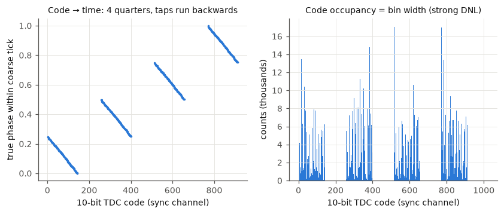
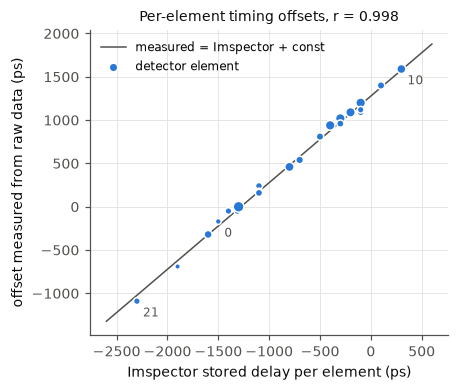
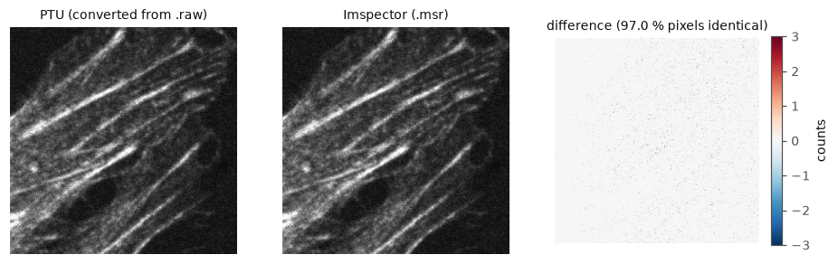
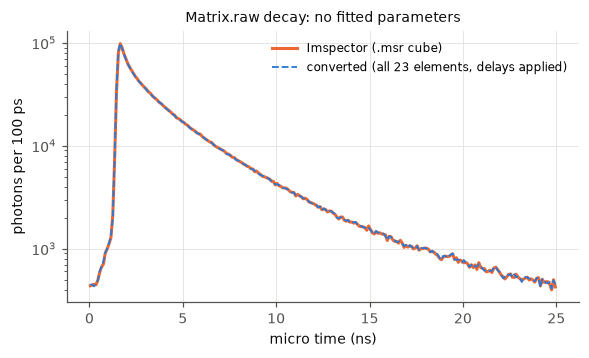
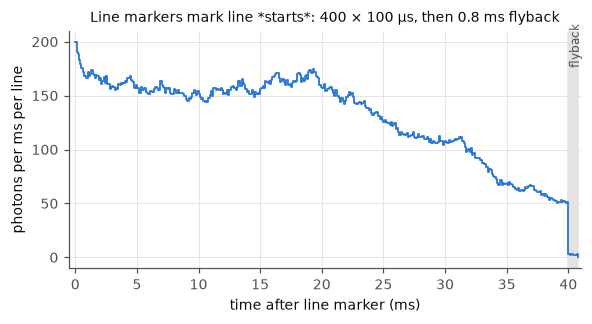
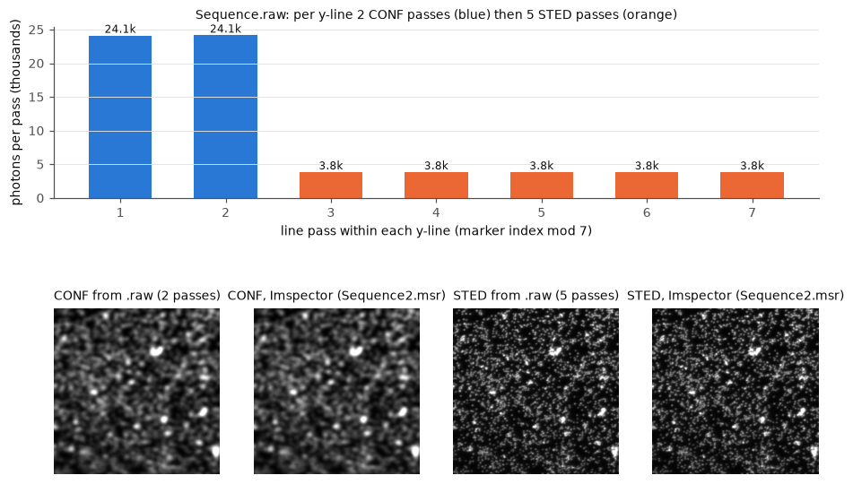

# MATRIX `.raw` → PTU: technical report

*matrix2ptu 0.1.0 — 2026-10-16*

Each statement is labelled with how strongly it is supported:

* **[V] verified**: shown directly by the data, or by agreement between independent sources.
* **[A] Abberior statement**: taken from the e-mails, and consistent with the data where it could be tested.
* **[H] hypothesis**: consistent with the data, but not proven.
* **[U] unresolved**: open question.

---

## 1. Summary

1. **An event-preserving conversion is feasible [V].** The `.raw` stream contains one
   record per detected photon, holding the detector element, a 16-bit coarse time stamp
   (~10.21 ns ticks) and a 10-bit TDC fine time. The laser sync is recorded on its own
   TDC channel for every 32nd pulse. From these, each photon's laser pulse
   (PTU *nsync*) and its micro time (PTU *dtime*) can be reconstructed. The precision
   is about 30–40 ps RMS, using a TDC calibration derived from the file itself.
2. **The conversion reproduces Imspector's own result [V].** For Matrix.raw, the PTU gives:
   * the same total counts as Imspector's FLIM cube in `Matrix.msr` (2 099 926 vs 2 099 914);
   * the same image (r = 0.9998; 97 % of pixels identical; the rest differ by ±1 photon at pixel edges);
   * the same decay histogram (χ²/bin = 2.3, normalised L1 distance 0.0097), with **no
     fitted parameters**.
   The per-element timing offsets measured from the raw data correlate r = 0.998 with
   Imspector's stored per-element delays (Fig. 2).
3. **Your acquisition model for Sequence.raw is correct [V].** For each y-line there are 2 passes of
   sequence 0 (`STAR RED_CONF`), then 5 passes of sequence 1 (`STAR RED_STED`). This is
   confirmed by three sources: the `.msr` settings (`line_steps = [2, 5]`), the number of
   line markers (3500 = 500 × 7), and the photon counts per pass, which repeat with
   period 7: [24.1k, 24.1k, 3.8k ×5] (Fig. 6). The **51 µs dwell applies to each
   individual pass [V]**. Imspector reports 102 µs (2 × 51) and 255 µs (5 × 51) as the
   accumulated per-channel dwell.
4. **Sequence.raw also reproduces Imspector's result [V]**, compared with
   `Sequence2.msr` (the `.msr` of the same acquisition, supplied later):
   * CONF: 24 130 286 vs 24 130 141 counts, r = 1.0000, 78 % of pixels identical;
   * STED: 9 536 834 vs 9 536 787 counts, r = 1.0000, 90 % of pixels identical;
   * decays: same peak bin, L1 = 0.005 (CONF) and 0.019 (STED). The remaining difference
     is a constant time offset of about 10 ps; with it removed, χ²/bin = 1.0 and 2.3 (§5).

   The first file supplied, `Sequence.msr`, has the same settings but shows a different
   field of view (r ≈ −0.07) and is not used any more.
5. **Outputs:** detector-resolved PTU (23 channels) and pooled PTU (1 channel), both
   HydraHarp-v2/MultiHarp T3 records, the same record type Imspector writes. Both are
   read correctly by ptufile, tttrkit and **napari-flopa's own core functions**, including
   the 2-sequence reconstruction with line accumulations (2, 5). **SymPhoTime has not been tested.**

---

## 2. Inputs inspected

| file | inspected | what it is |
|---|---|---|
| `Matrix.raw` (90 MB) | yes | headerless stream of 22 511 854 32-bit little-endian words, followed by 784 zero words of padding |
| `Sequence.raw` (597 MB) | yes | 149 160 181 words, followed by 777 zero words of padding |
| `Matrix.msr`, `Sequence2.msr` | yes | OBF container (Imspector 2025.10, spec 16.3): full parameter tree (XML) plus Imspector's TCSPC image cubes (Y × X × 250 bins of 100 ps, int16) and one 250-bin stack each (`Data010` / `STAR RED_STED {1} [Pop]`, probably a whole-image decay; not used) |
| `Sequence.msr` | yes | same settings as `Sequence2.msr`, but a **different acquisition** (different field of view); superseded |
| `SPAD.ptu` | yes | PTU written by **Imspector** for a MultiHarp 150 (400 × 400, 100 µs). Used as the template for record type, marker bits and image tags |
| `Intensity.tif` | yes | 400 × 400 **8-bit RGB colour rendering** (colour table applied), not photon counts. Usable only for correlation and orientation checks |

Documentation consulted:
* PI Imaging SPAD23 docs (piimaging.com/doc-pspad);
* PicoQuant PTU demos (GitHub, cloned);
* napari-flopa (GitHub commit `9602fcd`, 2026-09-30) and its reader `tttrkit` 0.1.6 (PyPI);
* ptufile 2026.8.8.

---

## 3. Source format findings

### 3.1 Word layout [A + V]

Abberior's "V5" description matches the data, using the most significant bits first:

| type (bits 31..26) | layout | observed |
|---|---|---|
| `1xxxxx` photon | `[1][5 element][10 TDC][16 coarse]` | elements 0–22: SPAD pixels; element 23: sync |
| `001FLP` marker | `[001][frame][line][pixel][10 payload][16 coarse]` | `001100` frame ×1, `001010` line ×400 / ×3500, payload always 0, **no pixel markers** |
| `000xxx` general | `[6 type][10 payload][16 coarse]` | none present |

* **23 detector elements [V].** Element numbers 0–22 occur. The firmware in the `.msr` is
  `SPAD23G_top_tdc_pcbv3_v33`, array `hex_23`. The element numbering equals Imspector's
  channel numbering: the per-element delays only line up with this mapping (r = 0.998).
* **Element 23 is the laser sync divided by 32 [V].** It occurs every 78.33 coarse ticks
  (800 ns). Its count matches the acquisition time: 20 410 631 × 800 ns = 16.33 s, against
  400 lines × 40.8 ms = 16.32 s. Note: in PI Imaging's *own* stream format, address 23
  means "coarse counter wraparound". **The PI encoding does not apply** to Abberior files.
* Abberior mentions "25 photon channels", a "dummy" channel and an optional "overflow" type.
  **None of these occur in either file [V].** The converter excludes and reports any element
  ≥ 23 other than the sync (via `detector.n_elements`).

### 3.2 Coarse counter and its wraparound [V]

* 16 bits, and it wraps silently (no overflow records), as Abberior says. Because the sync
  writes a record every ~78 ticks, consecutive words are never more than 81 ticks apart.
  The counter is therefore unwrapped exactly, using signed 16-bit differences between
  consecutive words.
* The stream is time-ordered to within −2 ticks (Matrix) and −4 ticks (Sequence), which
  is small reordering between TDCs.
* **Tick = 10.2127 ns (97.917 MHz) [V].** It is identical in both files to 1 ppm, and it
  is not the 100.8 MHz that PI quotes for non-TDC systems. It was measured in two
  independent ways (sync period and scanner line period).
* The coarse clock is **not** locked to the laser (78.334 ticks per 32 pulses).

### 3.3 TDC fine time [V, inferred from the data; Abberior's calibration is unpublished]

Fig. 1. Within short windows the sync train is strictly periodic, so the true phase of
every sync record is known; plotting that phase against the 10-bit code shows the code
structure:

* `code = [2-bit quarter q][8-bit delay-line tap]`, and the quarter adds q/4 of a coarse tick.
* Within a quarter, about 145 taps are used (≈ 17.6 ps per tap on average), and the tap
  number **decreases** as time increases.
* The differential non-linearity is strong: individual taps differ in width by more than 10×.
  A linear mapping is therefore wrong (1.3 ns RMS error).

**Calibration used:** statistical code-density calibration, for each element and for the
sync channel separately. Each element has its own TDC, and Abberior says each TDC is
calibrated separately. This is valid because photon arrival phases are uniform relative to
the free-running coarse clock.

Quality:
* sync time-stamp jitter is **37 ps RMS** (Matrix) and **25 ps RMS** (Sequence) per record;
* outliers occur at a rate of 2 × 10⁻⁷;
* the per-element residual offset after delay correction is ~30 ps RMS.

The calibration tables are saved with each conversion and can be re-used.

### 3.4 Laser sync and micro time [V]

* **Matrix.raw:** the laser is triggered by the FPGA's internal 40 MHz clock
  (`sync_source/input = -1`, 200 MHz ÷ 5). The data show exactly 1 632 000.000 pulses per
  line period.
* **Sequence.raw:** `sync_source/input = 1`, external. **The STED laser is the master
  clock.** Measured from the data: **40 000 566 Hz**. Imspector's own reading stored in
  `Sequence2.msr` (same acquisition) is 40 000 561 Hz, a difference of 0.13 ppm (the other
  `.msr` stored 40 000 567 Hz, so Imspector's reading drifts by a few Hz between sessions). The PTU sync rate and global
  resolution use the measured frequency.
* Is the sync wired into the MATRIX? **Yes [V].** The sync appears as element 23, and the
  ExpControl FPGA's sync output to the `Matrix1` stream is marked "required" in the `.msr`.
  For Matrix.raw the laser and that sync come from the same FPGA clock. For Sequence.raw
  they come from the STED laser input.
* Micro time = photon time minus the time of the preceding laser pulse. Pulses between two
  sync records are interpolated (32 equal steps), and the sync jitter is smoothed over 64
  records (~51 µs). The result is quantised to 5 ps in the PTU.
* **39 sync records are missing in Sequence.raw [V].** Each one coincides with a line
  marker, so the marker seems to take the slot. They are detected and bridged unambiguously.
* No conventional macro/micro time pair exists in the stream [A + V]. Both PTU times are
  *derived*, as Abberior describes.

### 3.5 Scan structure [V]

* The **line marker marks the line start.** The photon rate is uniform for 400 × 100 µs
  after the marker, then drops to 2 % during the 0.8 ms flyback (Fig. 5).
* **Pixel boundaries** are not encoded. Pixel = ⌊(t − t_line)/dwell⌋. There are no pixel
  markers and no line-end markers.
* The **frame marker** comes once, 0.8 ms before the first line.
* **Sequences and accumulations** are not encoded in the markers (the payload is always 0).
  They follow only from the order of the line markers plus the configuration:
  pass k → y = k // 7, sequence = [0,0,1,1,1,1,1][k mod 7].
* The **detector channel** (element) and the **acquisition sequence** are independent
  dimensions. All 23 elements contribute to both sequences.

### 3.6 Comparison with Imspector's pixel assignment [V + U]

* Matrix: 97 % of pixels are identical. Sequence: 78 % (CONF) and 90 % (STED); these
  images have more photons per pixel, so more pixels contain an edge photon. The share of
  photons involved is similar: 0.13 % (CONF) and 0.14 % (STED).
* The differing photons (Matrix ≈ 0.12 %) lie within ~200 ns of a pixel edge. Imspector's pixel
  grid appears shifted by about −140 ± 55 ns, varying from line to line. The rule
  Imspector uses is **unresolved [U]**.
* The effect is ≤ 0.2 % of the dwell and negligible for FLIM. `scan.line_start_offset_us`
  allows the grid to be shifted.

### 3.7 What the `.msr`/`.obf` provides (§10 of the task)

The `.msr` is an OBF file. It **does not contain photon events**, only histogram cubes, so
it cannot replace the `.raw`. It **is** valuable as a metadata source. It supplies:
* image size, pixel size and dwell;
* line steps (accumulations) and channel names;
* lasers;
* sync source and the measured laser frequency;
* **per-element delays** (needed for pooling);
* gating and crosstalk-filter settings;
* scan offsets (written to ImgHdr_X0/Y0).

Its histogram cubes are also an excellent validation reference. A metadata reader
(`obf.py`, `msr_meta.py`) was implemented. Saving the `.msr` alongside every `.raw` is recommended.

*Update 2026-10-21:* a **streamed** `.obf` (Matrix1 streaming format "OBF") is a different
kind of OBF file. It contains the same event words as a `.raw` and is converted by the
same pipeline; see [OBF_REPORT.md](OBF_REPORT.md). The statement above holds for `.msr`
and image `.obf` files.

---

## 4. PTU design

* **Record type:** `0x01010304` (HydraHarp v2 / MultiHarp T3, 32 bit), the same type
  Imspector writes:

  | field | bits | meaning |
  |---|---|---|
  | special | 1 | marker/overflow flag |
  | channel | 6 | 0–62 for photons |
  | dtime | 15 | max 32 768 bins |
  | nsync | 10 | sync count; overflow record = channel 63, nsync field = number of wraps |

  23 detector channels fit. Markers use channel bits 1/2/4.
* **nsync** = laser pulse index since the first sync record.
  * `MeasDesc_GlobalResolution` = measured laser period.
  * `TTResult_SyncRate` = round(1/period).
* **dtime** = micro time / 5 ps. There are 5000 bins per period: 25.000 ns for Matrix, and
  24.99965 ns for Sequence, where the last bin is 4.65 ps wide.
* **Markers:**
  * Frame = 4 (`ImgHdr_Frame = 3`) and LineStart = 1 (`ImgHdr_LineStart = 1`), both from the stream.
  * **LineStop = 2 is synthesised** at LineStart + pixels_x × dwell, because PTU readers
    (FLOPA, SymPhoTime) need it to define the line length. This is the only synthesised
    information. It is flagged in the header (`UsrMX_LineStopSynthesized`) and in `File_Comment`.
  * One LineStart/LineStop pair is written per **line pass**, i.e. 3500 for Sequence, in
    acquisition order. This is how Imspector writes sequence data for a MultiHarp.
* **Image tags** follow SPAD.ptu:
  * `ImgHdr_PixX/PixY`, `PixResol` (µm), `TimePerPixel` (ms, per pass), `X0/Y0`;
  * `Ident = 13`, `Dimensions = 3`, `BiDirect = False`.
* **Provenance tags (`UsrMX_*`):**
  * source file, output mode, meaning of the channel field;
  * sequence list with accumulations;
  * dwell convention;
  * TDC calibration method;
  * laser-frequency source;
  * delays applied (per element and common);
  * sync jitter.
* **Per-element delay correction:** Imspector's `delays/channel` and `delays/common`
  (−12.8 ns) from the `.msr` are added to the photon time *before* the pulse assignment. In
  the result, the IRFs of all elements coincide (residual ~30 ps RMS), and micro time 0 to
  25 ns matches Imspector's histograms. This is **essential for the pooled output**: without
  it the pooled IRF is about twice as wide (elements span 2.4 ns). Raw element times can be
  recovered by subtracting the delays listed in the header.
* **Pooled output** is built per event: each photon keeps its own nsync and delay-corrected
  dtime, and only the channel field is set to 0. Nothing is summed.
* **No events are invented or removed**, except photons outside the first–last sync record
  range, which have no pulse reference. There were 0 such photons in both files. Photons
  recorded during flyback, or before the first line, stay in the file; readers ignore them.

**Libraries [V]:**

| library | reads PTU | writes PTU | suitable as writer here |
|---|---|---|---|
| ptufile | yes | only from **histogram images** (synthesises events) | no; used as an independent **reader** |
| tttrkit 0.1.6 (FLOPA) | yes | no | used as an independent reader |
| tttrlib 0.26 | yes | yes (generic) | not needed; adds a C++ dependency |
| PicoQuant demos | yes | no | — |

A small dedicated writer (`ptu_writer.py`, ~150 lines) was therefore written.

---

## 5. Validation report

Validation command: `matrix2ptu convert <cfg> --validate`. Full results are in
`outputs/*/validation_report.json` and `run_log.txt`.

| check | Matrix (resolved / pooled) | Sequence (resolved / pooled) |
|---|---|---|
| S1 structure: ptufile reads the header and records; record count; event times monotonic; dtime < 5000 | PASS | PASS |
| S2 photons per channel = source (no loss) | PASS, 2 100 822 | PASS, 33 676 048 |
| S2 markers: 400/400/1 and 3500/3500/1 (start/stop/frame) | PASS | PASS |
| S3 exact round trip: every photon's (nsync, dtime, channel), in file order | PASS | PASS |
| S4 PTU micro time vs raw-derived micro time | PASS, ≤ 2.50 ps (half a bin) | PASS |
| I1 image from PTU markers vs image computed directly from raw time stamps | PASS: identical to pulse-based; 0.006 % of photons shift by a delay/pulse | PASS: 0.029 % |
| I2 image via **tttrkit** (FLOPA engine) vs own PTU image | PASS, identical; (1, 1, 400, 400, 23) | PASS, identical; **(1, 2, 500, 500, 23)** |
| I3 image vs Imspector cube in `.msr` (`Sequence2.msr` for Sequence) | PASS: r = 0.9998, 97.0 % identical pixels | PASS: r = 1.0000; CONF 78.3 %, STED 90.0 % identical pixels; totals differ by 145 and 47 photons |
| D1 decay vs Imspector cube | PASS: L1 = 0.0097, χ²/bin = 2.3, same peak bin | PASS: same peak bin; CONF L1 = 0.005, χ²/bin = 20; STED L1 = 0.019, χ²/bin = 48 (see note) |
| I4 vs Intensity.tif (RGB rendering) | PASS: r = 0.935 (red channel) | n/a |
| D2 per-element alignment after delay correction | PASS: 29 ps RMS | PASS: 32 ps RMS |

Additional checks:
* **napari-flopa core functions** (`read_ptu_file`, `reconstruct_ptu_to_dataset`, commit
  `9602fcd`), run headless by `tools/flopa_headless_check.py`:
  * Matrix: 2 099 926 photons in 23 channels;
  * Sequence: sequence 0 = 24 130 286, sequence 1 = 9 536 834, 23 channels;
  * phasors computed.
* **Split-sequence files** reconstructed with tttrkit: totals identical to the combined
  files. The 615 photons recorded before the first line marker belong to no pass.
* **Unit tests** on synthetic data, 6 tests: unwrapping across wraps, TDC calibration with
  known DNL, pulse train with and without missing syncs, T3 round trip including long gaps.
  Plus one end-to-end test on Matrix.raw. All pass.
* **Internal consistency of Sequence.raw:** the two CONF passes of the same y-line correlate
  r = 0.95, with the best match at zero line shift. The STED image shows the expected gain
  in resolution (Fig. 6).

**Note on D1 (micro time offset vs Imspector) [V + U].** The χ²/bin for Sequence looks
high because these decays have 10–24 M photons, so even tiny shape differences are
significant. Shifting the converted micro times by a constant brings the agreement down to
the Poisson limit: +10 ps gives χ²/bin 1.0 (CONF) and 2.3 (STED); for Matrix the best
shift is +5 ps (χ²/bin 0.9). So the converter's micro times are 5–10 ps earlier than
Imspector's. About 2.5 ps of this is expected, because the converter floors times into
5 ps bins. The rest is a convention difference whose origin is unknown [U] (for example
TDC calibration details or bin edges). It is far below the timing jitter (25–37 ps) and
Imspector's 100 ps bins, and irrelevant for lifetimes; it only matters for absolute
arrival times. No correction is applied.

**What was *not* tested:**
* SymPhoTime: not available here.
* The napari GUI of FLOPA: only its core functions were run.

---

## 6. Sequence.raw specifics

* The PTU contains all 3500 passes in acquisition order. FLOPA reconstructs them correctly
  with `line_accumulations = (2, 5)`.
* `ImgHdr_PixY = 500`. `ImgHdr_TimePerPixel = 0.051 ms` (per pass).
* The sequence structure is recorded in `UsrMX_Sequences = "0:STAR_RED_CONF:x2;1:STAR_RED_STED:x5"`.
  No standard PTU tag for this exists.
* **Gating:** Imspector had time gating active for the STED channel (0.75 ns delay, 8 ns
  width). The stored Imspector histograms are not gated. The PTU contains **all** photons;
  apply the gate in the analysis software if wanted.
* **Excitation:** the `.msr` shows **EXC640 + STED775** for this dataset (STAR RED), not
  488 nm. Matrix.raw used EXC488.

---

## 7. Detector-specific offsets and the pooled output

* The elements differ in timing by up to 2.4 ns. Imspector's delay table removes this to
  ~30 ps RMS, as verified on both files.
* The pooled output is only meaningful with this correction. It is applied by default
  (`apply_element_delays: true`) using the table from the `.msr`.
* If the hardware is re-calibrated, the table in the `.msr` of *that* measurement must be used.
* Weak edge elements (0, 4, 22: 0.1–0.3 % of photons) have the least precise residual offsets.
* Not corrected:
  * element-specific IRF shape;
  * crosstalk (Imspector's crosstalk filter was **off**, so the raw stream is unfiltered);
  * dead-time and pile-up effects.

---

## 8. Compatibility

**FLOPA / tttrkit [V, headless]:**
* All format requirements are met: T3 32-bit decoding, overflow channel 63 with a count,
  marker bits 1/2/4, LineStop needed for the line length, `TTResult_SyncRate`,
  `MeasDesc_Resolution` and `TTResultFormat_WrapAround`.
* Sequences are handled with the `line_accumulations` tuple, entered by the user.
* Channel dimension: up to 64.
* FLOPA reports "Frame Count: N/A", because `ImgHdr_NumberOfFrames` is not written; Imspector
  does not write it either. Frames default to the GUI setting.
* Pixel assignment in FLOPA uses nsync, so pixel edges are quantised to 25 ns, which is negligible.

**SymPhoTime 64 [not tested; requirements from the format]:**
* Uses the same record type and image tags as Imspector's MultiHarp PTUs. Those open in
  SymPhoTime, according to your workflow.
* Open points:
  1. `HW_Type` is set to an honest non-PicoQuant string. If SymPhoTime rejects it, set
     `output.hw_type: "MultiHarp 150 4P"`.
  2. 23 detector channels: SymPhoTime may limit channels to what the declared hardware
     supports (MultiHarp 150 has 4–16 inputs). Try the **pooled** file first.
  3. Sequences: SymPhoTime cannot handle line-interleaved sequences (your observation). Use
     `split_sequences: true`. Each per-sequence file then has `pixels_y × accumulation` lines.
* Please report the SymPhoTime version and its behaviour.

---

## 9. Limitations and open questions

1. **Micro time offset vs Imspector:** 5–10 ps, constant, origin unresolved (§5) [U].
2. **TDC calibration** is self-derived (code density), not Abberior's. Agreement with
   Imspector: same decay shape, with small differences (≤ ~20 ps) on the steep rising edge.
   Files with few photons per element (< ~10⁴) give poorer tables. In that case, re-use a
   table from a brighter measurement (`timing.tdc_calibration_file`).
3. **Imspector's exact pixel-edge rule** is not reproduced (0.12 % of photons move by one
   pixel) [U].
4. **Physical element geometry:** numbers 0–22 equal Imspector's channel numbers [V], but
   their positions in the hexagonal array (needed for pixel reassignment) are not established
   here [U]. PI documents pixel 0 at "top-left toward the USB-C connector". Use the drawing
   in the PI docs and verify with a bead scan.
5. **Not implemented:** bidirectional and harmonic scanning, multiple frames (code paths
   exist, but are untested for lack of data), pixel markers (none in the data), and the
   "dummy"/"overflow" record types (not observed).
6. **Memory:** conversion peaks at about 2.5× the `.raw` size (1.5 GB for the 600 MB
   file; it was 7.2 GB before BACKLOG.md items A and B). The `.raw` is read block-wise and
   the sync records are never held in memory. The per-photon arrays are still held in
   full, so memory grows with the photon count. With `--validate` the total is 2.7 GB:
   validation keeps 16 more bytes per photon and reads the PTU files block by block
   ([BACKLOG.md](BACKLOG.md) item D).
7. **Format stability:** the stream layout is "V5" (Abberior). Other firmware versions may
   differ. The decoder checks its assumptions (time order, sync regularity, marker counts)
   and stops with an explanation if they fail.

## 10. Recommended next steps

1. Always save the `.msr` together with the `.raw` of each acquisition. It provides the
   settings and the reference for validation.
2. Test the PTU files in SymPhoTime (start with pooled Matrix). If needed, try
   `hw_type: "MultiHarp 150 4P"` and `split_sequences: true`.
3. Open the files in the FLOPA GUI to confirm what the headless test showed.
4. For pixel reassignment: establish the element → (x, y) map in the hexagonal array (bead
   scan), then build on `converter.DecodedAcquisition`.

---

## Figures

| | |
|---|---|
|  Fig. 1 TDC code structure (sync channel) |  Fig. 2 per-element offsets vs Imspector delays |
|  Fig. 3 Matrix: PTU vs Imspector |  Fig. 4 Matrix decay vs Imspector |
|  Fig. 5 photon rate after the line marker |  Fig. 6 Sequence pass structure and images |
